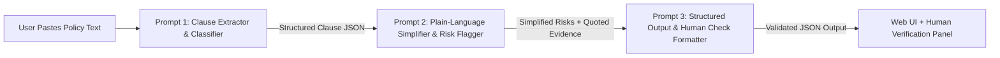
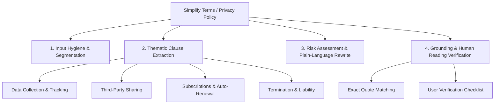
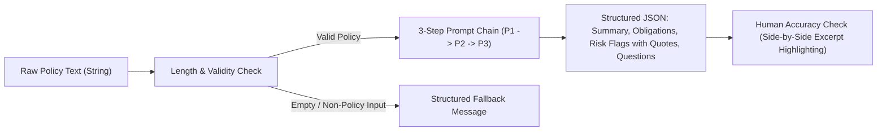
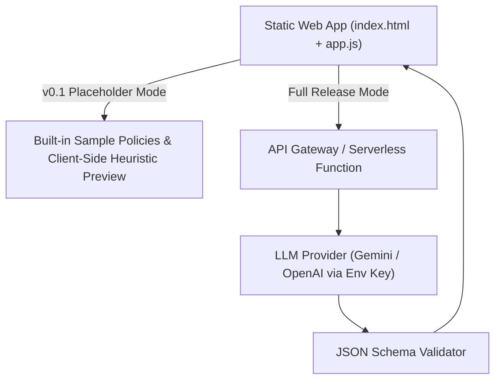

# Architecture & Prompt Workflow Diagrams

These diagrams support **Section 2(b)** of the Milestone 2 report for **T&C Buster (AI-Powered Terms and Conditions Simplifier, C18)**.

## 1. Prompt Workflow (3-Step Chaining)

## 2. Task Decomposition

## 3. Input–Output Flow

## 4. System Architecture (v0.1 Placeholder vs Full Release)

